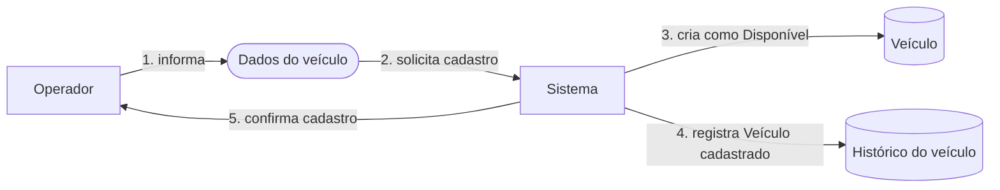
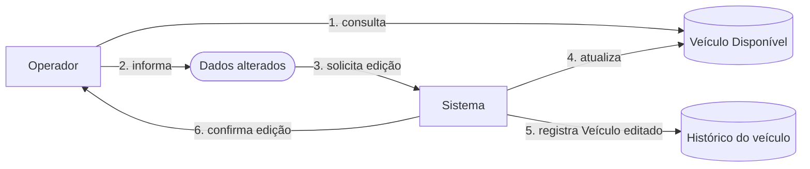
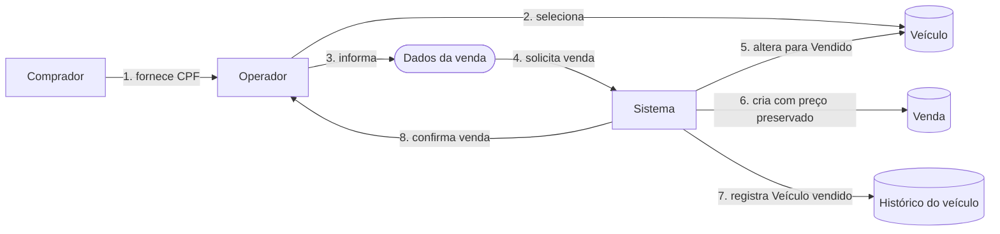
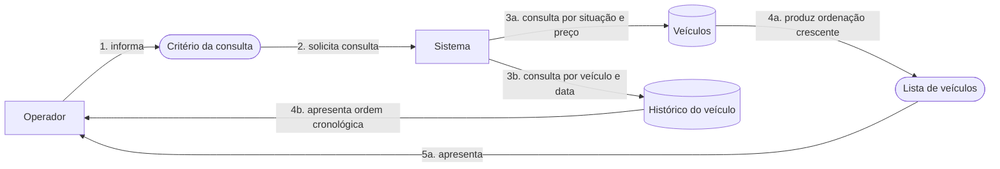

# Domain Storytelling da gestão de veículos

## Objetivo

Este documento descreve como os atores realizam as atividades principais da Plataforma de Gestão de Veículos. As histórias apresentam a sequência de trabalho, os objetos utilizados e as regras aplicadas em cada fluxo.

Os termos seguem a [linguagem ubíqua](linguagem-ubiqua.md) do contexto Gestão de Veículos. As definições de [atores](linguagem-ubiqua.md#atores), [objetos do domínio](linguagem-ubiqua.md#termos-do-domínio) e [invariantes](linguagem-ubiqua.md#invariantes) permanecem centralizadas naquele documento.

## Notação

- Retângulos representam atores ou o sistema.
- Formas cilíndricas representam objetos de trabalho persistidos.
- Formas com cantos arredondados representam dados utilizados durante uma atividade.
- Setas numeradas representam as atividades na ordem em que acontecem.
- O Sistema representa a Plataforma de Gestão de Veículos e não introduz um novo ator de negócio.

## História 1 - Cadastrar veículo

### Situação inicial

O Operador possui os dados de um veículo que deve entrar no catálogo.

### Sequência

1. O Operador informa marca, modelo, ano de fabricação, cor e preço anunciado.
2. O Operador solicita o cadastro ao Sistema.
3. O Sistema valida os dados, gera um identificador e cria o Veículo como Disponível.
4. O Sistema registra o evento Veículo cadastrado no Histórico do veículo.
5. O Sistema devolve a confirmação e os dados do Veículo cadastrado.

### Invariantes aplicadas

Esta história aplica as invariantes `INV-01`, `INV-02`, `INV-03`, `INV-04`, `INV-05`, `INV-12`, `INV-13` e `INV-14`.

### Resultado

Um novo Veículo está Disponível no catálogo e seu cadastro pode ser consultado no histórico.

### Situações de erro

- Dados obrigatórios ausentes ou formados apenas por espaços.
- Ano de fabricação inválido.
- Preço anunciado inválido.
- Falha ao persistir o Veículo ou seu histórico. Nesse caso, nenhum dos dois registros deve permanecer salvo.

## História 2 - Editar veículo disponível

### Situação inicial

O Operador selecionou um Veículo Disponível e precisa alterar um ou mais dados.

### Sequência

1. O Operador consulta o Veículo que deseja alterar.
2. O Operador informa os novos valores.
3. O Operador solicita a edição ao Sistema.
4. O Sistema confirma que o Veículo está Disponível, valida os dados e aplica somente as alterações efetivas.
5. O Sistema registra o evento Veículo editado com os valores anteriores e novos.
6. O Sistema devolve os dados atualizados.

### Invariantes aplicadas

Esta história aplica as invariantes `INV-02`, `INV-03`, `INV-04`, `INV-06`, `INV-12`, `INV-13` e `INV-15`.

### Resultado

O Veículo permanece Disponível com os novos dados, e as diferenças ficam registradas no histórico.

### Situações de erro

- Veículo não encontrado.
- Tentativa de editar um Veículo Vendido.
- Novo valor inválido.
- Concorrência com outra alteração ou com o registro da venda.
- Falha ao persistir a edição ou o histórico.

## História 3 - Registrar venda

### Situação inicial

Um Comprador decidiu adquirir um Veículo Disponível, e o Operador precisa registrar a operação.

### Sequência

1. O Comprador fornece seu CPF ao Operador.
2. O Operador seleciona o Veículo Disponível.
3. O Operador informa o CPF do comprador e a data da venda.
4. O Operador solicita o registro da venda ao Sistema.
5. O Sistema valida os dados e altera a situação do Veículo para Vendido.
6. O Sistema cria a Venda preservando o preço anunciado vigente.
7. O Sistema registra o evento Veículo vendido no histórico.
8. O Sistema devolve a confirmação da venda.

### Invariantes aplicadas

Esta história aplica as invariantes `INV-06`, `INV-07`, `INV-08`, `INV-09`, `INV-10`, `INV-11`, `INV-12`, `INV-13`, `INV-14` e `INV-16`.

### Resultado

O Veículo passa a estar Vendido, a Venda fica registrada e o fato pode ser consultado no histórico.

### Situações de erro

- Veículo não encontrado.
- Veículo já vendido.
- CPF inválido.
- Data da venda inválida.
- Duas tentativas concorrentes de vender o mesmo Veículo. Somente uma pode ser concluída.
- Falha em qualquer gravação da transação.

## História 4 - Consultar veículos e histórico

### Situação inicial

O Operador precisa consultar o catálogo ou entender as mudanças ocorridas com um Veículo.

### Sequência

1. O Operador escolhe consultar Veículos Disponíveis, Veículos Vendidos ou o histórico de um Veículo.
2. O Operador solicita a consulta ao Sistema.
3. Para o catálogo, o Sistema filtra pela situação solicitada. Para o histórico, localiza os registros do Veículo.
4. O Sistema ordena o catálogo pelo preço aplicável ou o histórico pela data do evento.
5. O Sistema apresenta o resultado ao Operador.

### Invariantes aplicadas

Esta história aplica as invariantes `INV-13`, `INV-17`, `INV-18`, `INV-19` e `INV-20`.

### Resultado

O Operador recebe uma lista determinística ou o histórico cronológico solicitado.

### Situações de erro

- Veículo não encontrado na consulta de histórico.
- Critério de consulta inválido.
- Falha de acesso aos dados.

Uma consulta válida sem resultados devolve uma coleção vazia e não representa erro.
