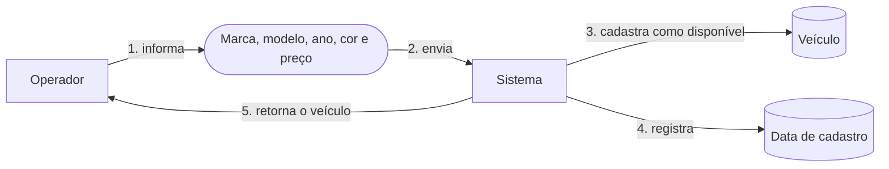
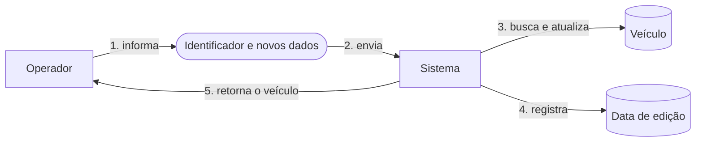
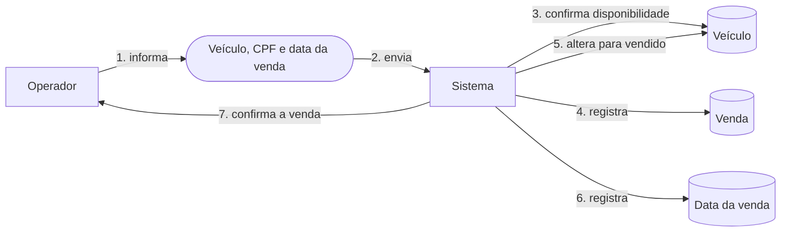
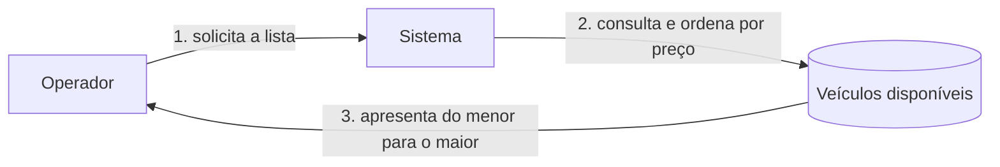
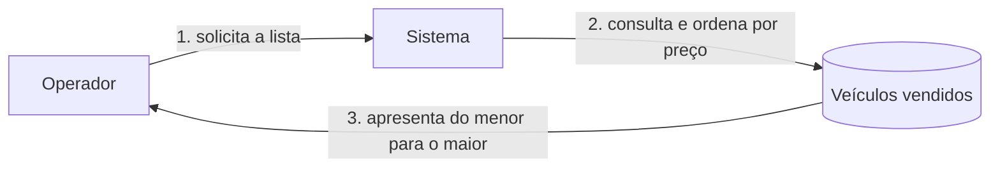

# Domain Storytelling da gestão de veículos

## Objetivo

Este documento descreve como o Operador usa a plataforma para administrar o catálogo e registrar vendas. Os termos seguem a [linguagem ubíqua](linguagem-ubiqua.md).

## Notação

- Retângulos representam o Operador ou o Sistema.
- Formas arredondadas representam informações usadas no fluxo.
- Formas cilíndricas representam dados persistidos.
- Setas numeradas indicam a ordem das atividades.

## História 1 - Cadastrar veículo

1. O Operador informa marca, modelo, ano, cor e preço.
2. O Sistema valida os dados.
3. O Sistema cadastra o Veículo com a situação `DISPONIVEL`.
4. O Sistema registra a data do cadastro.
5. O Sistema retorna o Veículo cadastrado.

## História 2 - Editar veículo

1. O Operador informa o identificador e os novos dados.
2. O Sistema busca o Veículo.
3. O Sistema valida os dados informados e atualiza o registro.
4. O Sistema registra a data da edição.
5. O Sistema retorna o Veículo atualizado.

## História 3 - Registrar venda

1. O Operador informa o identificador do Veículo, o CPF do comprador e a data da venda.
2. O Sistema valida o CPF e a data.
3. O Sistema busca o Veículo e confirma que ele está disponível.
4. O Sistema registra a Venda.
5. O Sistema altera a situação do Veículo para `VENDIDO`.
6. O Sistema registra a data da venda.
7. O Sistema retorna a confirmação da Venda.

O registro da Venda, a alteração da situação e a data da venda são persistidos na mesma operação.

## História 4 - Listar veículos disponíveis

1. O Operador solicita os veículos disponíveis.
2. O Sistema consulta os veículos com situação `DISPONIVEL`.
3. O Sistema apresenta a lista do menor para o maior preço.

Uma consulta sem resultados devolve uma lista vazia.

## História 5 - Listar veículos vendidos

1. O Operador solicita os veículos vendidos.
2. O Sistema consulta os veículos com situação `VENDIDO`.
3. O Sistema apresenta a lista do menor para o maior preço.

Uma consulta sem resultados devolve uma lista vazia.
