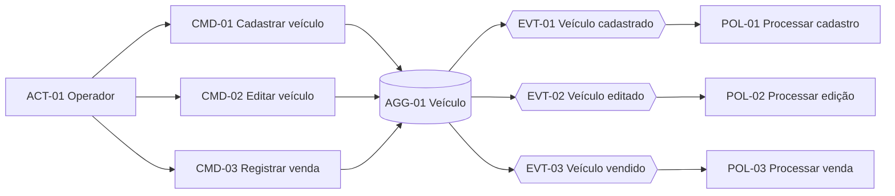
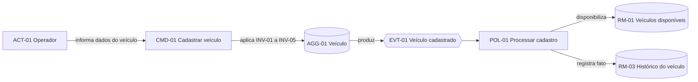
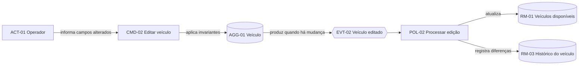
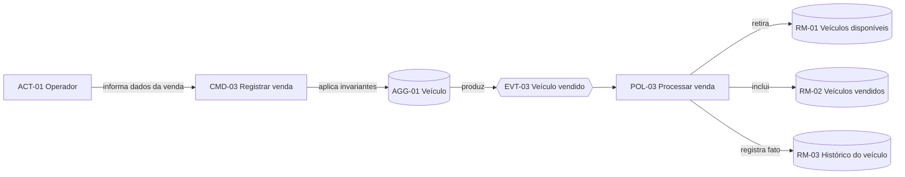
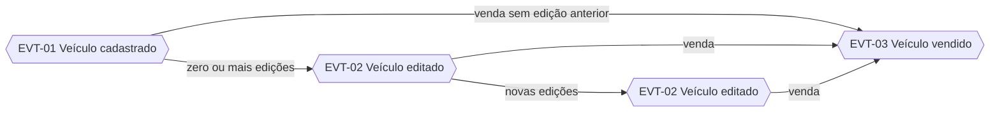
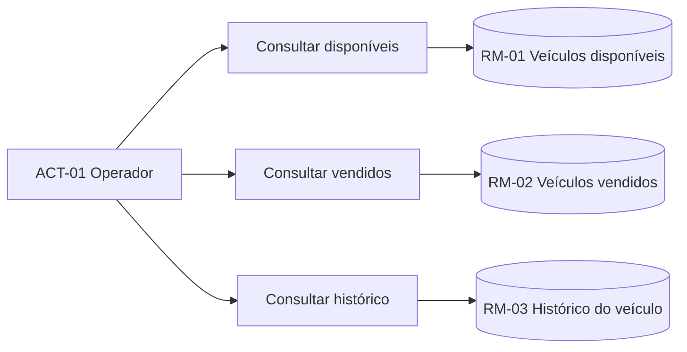

# Event Storming da gestão de veículos

## Objetivo

Este documento organiza os fluxos do contexto Gestão de Veículos a partir das intenções dos atores, decisões do agregado e fatos produzidos pelo domínio.

As definições oficiais estão na [linguagem ubíqua](linguagem-ubiqua.md), e a ordem das atividades está detalhada no [Domain Storytelling](domain-storytelling.md). Este documento referencia as invariantes sem repetir seu conteúdo.

## Notação

- `ACT`: ator que inicia uma ação.
- `CMD`: comando que expressa uma intenção.
- `AGG`: agregado que protege as invariantes.
- `EVT`: evento de domínio que registra um fato ocorrido.
- `POL`: política que reage a um fato e coordena seus efeitos.
- `RM`: modelo de leitura usado nas consultas.
- `HOT`: ponto de atenção que exige decisão ou cuidado técnico.

Os eventos representam fatos do negócio. O uso dessa terminologia não determina Event Sourcing nem exige um barramento de mensagens.

## Visão geral

## Ator

### ACT-01 - Operador

Inicia os comandos de cadastro, edição e venda. Também solicita os modelos de leitura do catálogo e do histórico.

O Comprador participa da história de venda, mas não envia comandos diretamente à plataforma nesta versão.

## Agregado

### AGG-01 - Veículo

O Veículo é a raiz do agregado e decide se os comandos podem ser executados. Ele protege a consistência dos dados comerciais, da situação, da venda e dos eventos produzidos.

A Venda pertence ao ciclo de vida desse agregado e somente pode ser criada pelo comando Registrar venda.

## Fluxo 1 - Cadastro

### CMD-01 - Cadastrar veículo

Intenção de incluir um novo Veículo no catálogo. Recebe marca, modelo, ano de fabricação, cor e preço anunciado.

O agregado aplica `INV-01`, `INV-02`, `INV-03`, `INV-04`, `INV-05`, `INV-12`, `INV-13` e `INV-14`.

### EVT-01 - Veículo cadastrado

Fato produzido quando o cadastro foi aceito. Contém o identificador, os dados iniciais, a situação Disponível e o momento do cadastro.

### POL-01 - Processar cadastro

Persiste o Veículo e seu histórico na mesma transação. Após a confirmação, o Veículo passa a compor o modelo de leitura de disponíveis.

O evento somente é considerado concluído quando estado e histórico foram gravados com sucesso.

## Fluxo 2 - Edição

### CMD-02 - Editar veículo

Intenção de modificar um ou mais dados de um Veículo Disponível. Recebe o identificador do Veículo e somente os campos que devem ser alterados.

O agregado aplica `INV-02`, `INV-03`, `INV-04`, `INV-06`, `INV-12`, `INV-13` e `INV-15`.

### EVT-02 - Veículo editado

Fato produzido quando ao menos um valor foi efetivamente alterado. Contém o identificador do Veículo, os valores anteriores e novos dos campos modificados e o momento da edição.

Uma solicitação sem mudanças não produz este evento.

### POL-02 - Processar edição

Persiste o novo estado e o histórico das diferenças na mesma transação. O modelo de leitura de disponíveis passa a refletir os dados atualizados.

## Fluxo 3 - Venda

### CMD-03 - Registrar venda

Intenção de vender um Veículo Disponível. Recebe o identificador do Veículo, o CPF do comprador e a data da venda.

O agregado aplica `INV-06`, `INV-07`, `INV-08`, `INV-09`, `INV-10`, `INV-11`, `INV-12`, `INV-13`, `INV-14` e `INV-16`.

### EVT-03 - Veículo vendido

Fato produzido quando a venda foi aceita. Contém o identificador do Veículo, os dados da Venda, o preço preservado e o momento do registro.

### POL-03 - Processar venda

Persiste a situação Vendido, a Venda e o histórico na mesma transação. Após a confirmação, o Veículo deixa o modelo de disponíveis e passa a compor o modelo de vendidos.

A política deve garantir que apenas uma tentativa concorrente conclua a venda do mesmo Veículo.

## Linha do tempo do agregado

Depois de `EVT-03`, o agregado não aceita novos comandos de edição ou venda nesta versão.

## Modelos de leitura

Os modelos de leitura não alteram o agregado e aplicam `INV-17`, `INV-18`, `INV-19` e `INV-20`.

### RM-01 - Veículos disponíveis

Apresenta somente Veículos Disponíveis, ordenados pelo preço anunciado e pelo identificador como desempate.

### RM-02 - Veículos vendidos

Apresenta somente Veículos Vendidos, ordenados pelo preço da venda e pelo identificador como desempate.

### RM-03 - Histórico do veículo

Apresenta os eventos de um Veículo em ordem cronológica crescente. O conteúdo é imutável conforme `INV-13`.

Consultas são representadas separadamente dos comandos porque não expressam intenção de alterar o domínio e não produzem eventos.

## Matriz de rastreabilidade

- `CMD-01` é decidido por `AGG-01`, produz `EVT-01` e aciona `POL-01`.
- `CMD-02` é decidido por `AGG-01`, pode produzir `EVT-02` e aciona `POL-02` quando há mudança.
- `CMD-03` é decidido por `AGG-01`, produz `EVT-03` e aciona `POL-03`.
- `POL-01` atualiza `RM-01` e `RM-03`.
- `POL-02` atualiza `RM-01` e `RM-03`.
- `POL-03` atualiza `RM-01`, `RM-02` e `RM-03`.

## Pontos de atenção

### HOT-01 - Venda concorrente

Duas solicitações podem tentar vender o mesmo Veículo. A persistência deve usar bloqueio ou atualização condicional para garantir `INV-08` sem depender apenas de validação em memória.

### HOT-02 - Atomicidade do histórico

Estado atual, Venda e histórico não podem divergir. Os efeitos descritos pelas políticas são síncronos e transacionais nesta versão, conforme `INV-12`.

### HOT-03 - Proteção do CPF

O CPF é necessário para a Venda, mas sua exposição precisa ser limitada. Logs e erros seguem `INV-16`; mascaramento nas respostas ainda requer decisão de produto.

### HOT-04 - Paginação

Os modelos de leitura definem filtro e ordenação, mas o contrato de paginação ainda precisa ser decidido antes da exposição pública da API.

### HOT-05 - Cancelamento de venda

O fluxo atual termina em Veículo Vendido. Uma futura operação de cancelamento exigirá novos comandos, eventos, transições e regras, sem alteração direta dos fatos existentes.

## Decisões de modelagem

- O contexto possui um único agregado nesta versão.
- A Venda não recebe comandos diretamente.
- O histórico é uma consequência obrigatória dos eventos do agregado.
- Os modelos de leitura podem consultar tabelas relacionais diretamente, sem criar novos agregados.
- As políticas representam responsabilidades lógicas e podem ser executadas de forma síncrona na mesma aplicação.
- Não existe dependência de sistemas externos nos fluxos atuais.
