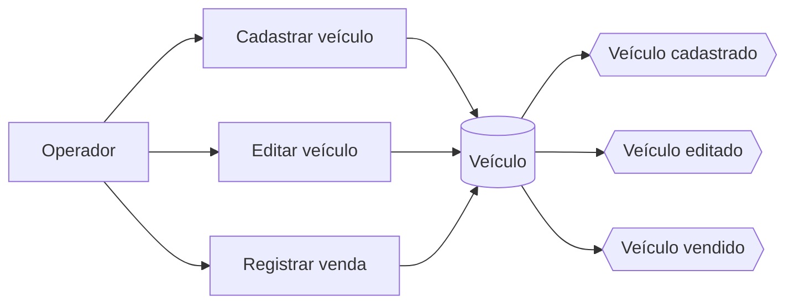
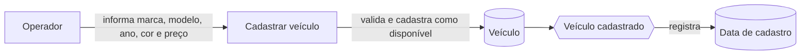
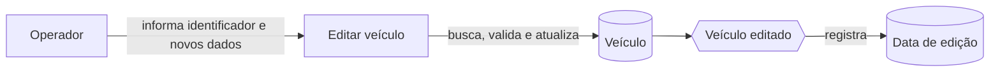
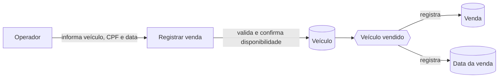
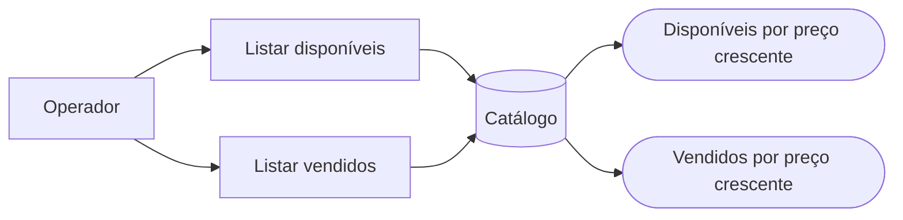
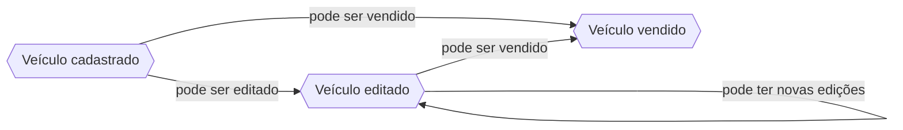

# Event Storming da gestão de veículos

## Objetivo

Este documento relaciona as intenções do Operador aos fatos relevantes da Gestão de Veículos. As definições dos termos estão na [linguagem ubíqua](linguagem-ubiqua.md), e a sequência das atividades está no [Domain Storytelling](domain-storytelling.md).

## Notação

- **Ator**: quem inicia uma ação.
- **Intenção ou comando de negócio**: o que o ator deseja realizar.
- **Agregado Veículo**: conceito central que recebe as alterações.
- **Fato ou evento de domínio**: resultado de uma ação concluída.

Intenções e fatos são elementos da modelagem. Eles não representam classes obrigatórias, CQRS, Event Sourcing ou comunicação assíncrona no código.

## Visão geral

## Cadastro do veículo

O fato **Veículo cadastrado** indica que o Veículo entrou no catálogo com situação `DISPONIVEL` e que a data do cadastro foi registrada.

## Edição do veículo

O fato **Veículo editado** indica que os dados do Veículo foram atualizados e que a data da edição foi registrada.

## Venda do veículo

O fato **Veículo vendido** indica que a Venda foi registrada, a situação do Veículo passou para `VENDIDO` e a data da venda foi registrada.

## Consultas do catálogo

As consultas não alteram o Veículo e não produzem novos fatos. Elas filtram o catálogo pela situação solicitada e ordenam o resultado pelo preço do menor para o maior.

## Sequência dos fatos

Cada cadastro, edição e venda registra a data correspondente. Os fatos descrevem o resultado observado no domínio, enquanto a implementação realiza os fluxos de forma direta e síncrona.
